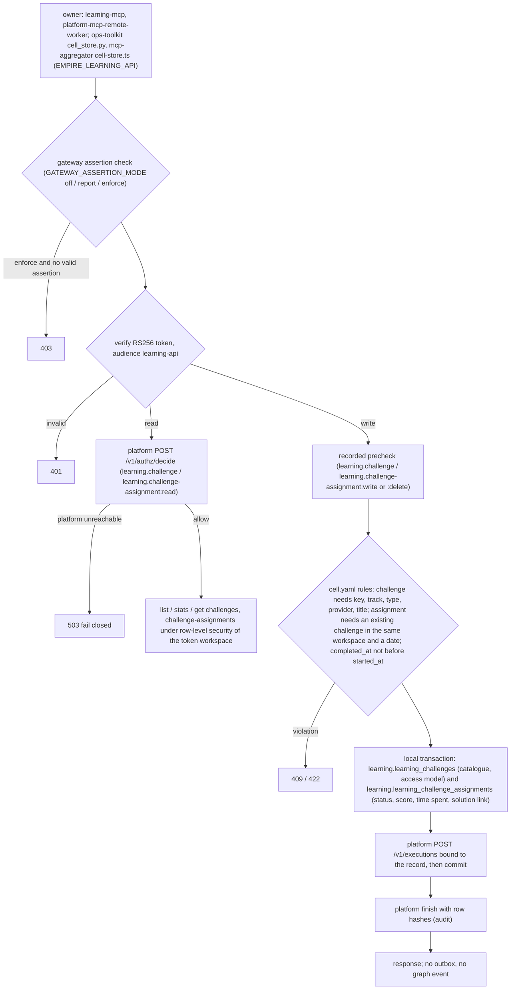

# 01 — Business process (As-Is / To-Be)

life-learning-api คือ cell ที่เก็บแคตตาล็อก challenge สำหรับฝึก (coding, quiz, study, project, competition) และบันทึกการ assign challenge ให้ owner พร้อมผล ผู้เรียกคือ owner ผ่าน `learning-mcp`, hosted tool hub และ owner tooling ด้วย token ของ `empire-platform`; ไม่มีหน้าเว็บใดอ่าน cell นี้ และไม่ส่ง graph event

Last reviewed: 2026-11-27 · commit `cba7934`

## As-Is (จากโค้ดวันนี้)

Sources: `cell.yaml`, `migrations/0001_learning.sql`, `pyproject.toml` (pinned `platform-cellkit` 1.0.11: `cellkit/app.py` `allow`, `write`, `emit`, erase route; `cellkit/server.py` gateway install; `cellkit/spec.py` `audience`), `README.md`, `PRODUCT.md` §Users

ข้อเท็จจริงสำคัญจากโค้ด:

- `/v1/challenges` (filter `challenge_type`, `category`) และ `/v1/challenge-assignments` (filter `challenge_id`, `status`): list, stats, get, get-by-legacy-id, create (`Idempotency-Key`), patch (`expected_version`), delete และ `POST /v1/<plural>/erase` (ลบทั้ง workspace ของผู้เรียก, ต้องมี `:delete` และยืนยัน workspace id ของตัวเอง)
- challenge ที่ยังมี assignment ลบไม่ได้ (409 `has_dependents`); assignment ที่อ้าง challenge ที่ไม่มีใน workspace ได้ 422 `reference_not_found`
- ไม่มี `graph:` ใน `cell.yaml` จึงไม่เขียน outbox และไม่มี service publisher; การเขียนทุกครั้งมีเฉพาะ execution และ audit (row hashes) ที่ platform
- `rotation_order` ถูกเก็บแต่ไม่มีโค้ดใดใช้ assign หรือหมุน challenge; `progress_log` เดิมยังอยู่ใน SQLite (นอก cell นี้)
- `GATEWAY_ASSERTION_MODE` ค่าเริ่มต้น `off`; ค่าที่ใช้ใน production [ต้องยืนยัน]

## To-Be

ไม่มี To-Be ที่เขียนไว้

## Gap

| ID | As-Is → To-Be | Status | Owner | Evidence |
|---|---|---|---|---|
| G1 | ไม่มี To-Be ที่เขียนไว้ (PRODUCT.md มีแค่ตัววัดที่เสนอโดยไม่มีเป้า, specs เป็นงาน baseline / test) → owner กำหนด To-Be ของ cell นี้ | decide | owner | `PRODUCT.md` §Measures ("Proposed (nothing collects them yet)"); `specs/001-l2-baseline/spec.md`, `specs/002-cellkit-test-depth/spec.md` |

## Open questions

- `GATEWAY_ASSERTION_MODE` ใน production เป็น `report` หรือ `enforce` [ต้องยืนยัน]
